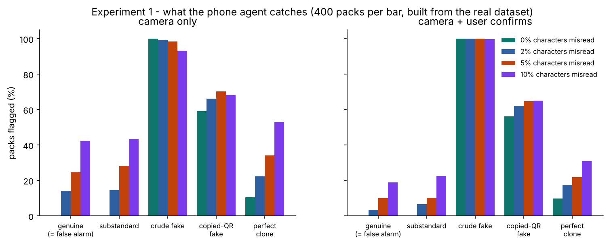
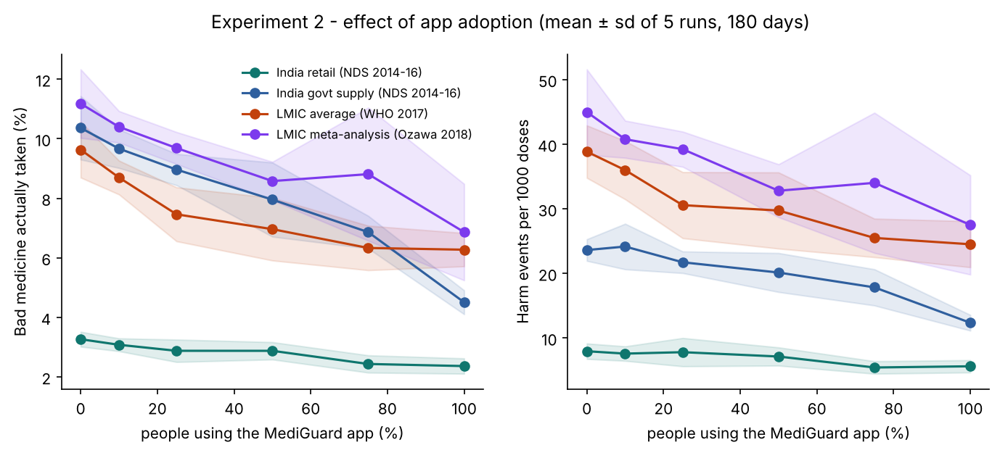
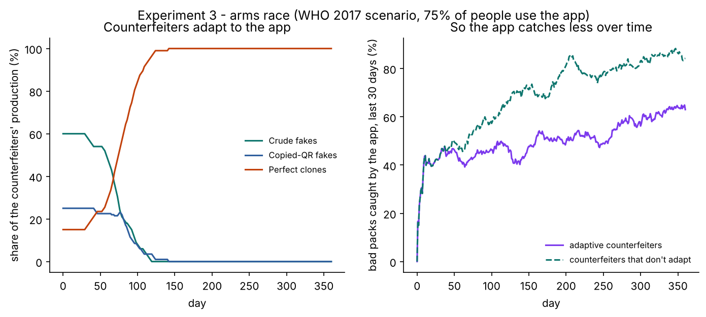
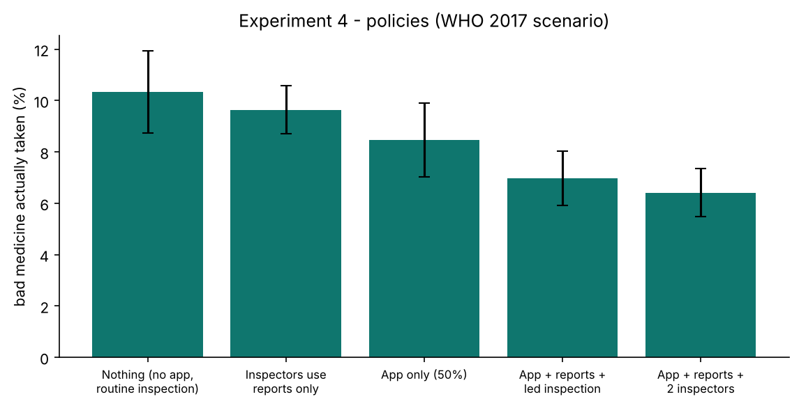

# MediGuard: Detecting Fake Medicine with a Phone-Based AI Agent and Testing Its Social Impact with an Agent-Based Model

*Fundamentals of AI – case study*

---

## 1. Problem

Substandard and falsified (S&F) medicines are medicines that fail quality standards (substandard) or
deliberately misrepresent what they are or where they come from (falsified / spurious).

* **WHO (2017):** a review of the evidence behind its Global Surveillance and Monitoring System found an estimated
  **10.5 %** of medical products in low- and middle-income countries (LMICs) are S&F. A University of Edinburgh
  model cited by WHO suggests **72,000–169,000 children** may die each year from pneumonia because of S&F antibiotics.
  WHO's current fact sheet still says at least 1 in 10, and puts spending on S&F products at **US$ 30.5 billion a year**. [1]
* **Ozawa et al. (2018), JAMA Network Open:** meta-analysis of 96 studies (67,839 samples): **13.6 %** S&F
  prevalence in LMICs; 19.1 % of antimalarials and 12.4 % of antibiotics. [2]
* **India – National Drug Survey 2014-16 (MoHFW / NIB):** retail outlets **3.16 %** not of standard quality (NSQ)
  and **0.0245 %** spurious; government supply **10.02 %** NSQ and **0.059 %** spurious. [3]
* **India's response:** since 1 August 2023, the top 300 brands must carry a QR / barcode with product ID, batch,
  dates and maker (G.S.R. 823(E), Schedule H2 of the Drugs Rules), and in 2026 this was extended to whole drug
  categories (vaccines, anti-cancer, narcotic, then antimicrobial medicines). [4]

A patient holding a strip cannot tell a fake from a genuine pack. **Goal:** an AI agent on an ordinary phone that
(a) spots warning signs of a fake, (b) explains them in plain words, (c) suggests safer / cheaper medicines with the
same composition, and (d) a simulation that estimates how much harm such an app could prevent in a real town.

## 2. Related work

| Work | What it says | How MediGuard uses it |
|---|---|---|
| Kovacs et al. 2014, *PLoS ONE* [5] | Reviewed 42 detection technologies for LMICs. No single tool works for everything: they fill niches, from simple packaging checklists to mass spectrometry. | MediGuard is the cheapest niche (packaging + data checks). It is honest that substandard tablets need a lab. |
| Mackey & Nayyar 2017, *Expert Opin. Drug Saf.* [6] | Digital tools against fakes fall into 5 groups: mobile, RFID, advanced computing, online verification, blockchain. | MediGuard combines mobile scanning, computing (rule agent + fuzzy matching) and an alert list (online verification). |
| Ackland et al. 2019, *JASSS* [7] | Agent-based model of a self-organising pharmaceutical supply chain with poor-quality medicines: trust built from experience shapes the market. | Patients in our model choose shops by trust built from experience and reports. |
| Kazil, Masad & Crooks 2020, *SBP-BRiMS* [8] | The Mesa framework for agent-based modelling in Python. | Our town model is built in Mesa 3 with a Solara dashboard. |
| CDSCO guidance on spurious drugs [9] | How regulators identify and verify spurious drugs; monthly drug alerts. | Rules for batch / maker / label checks; the alert-list rule. |

## 3. Dataset

**A-Z Medicine Dataset of India** (Shudhanshu Singh, Kaggle) [10]: **253,973** allopathic medicines with name,
price (₹), discontinued flag, manufacturer (**7,648**), pack size and up to two salts with strengths.

Cleaning (`mediguard/dataset.py`):

* `Glycomet 500 SR Tablet` → brand key `GLYCOMET 500`, form `tablet sr` (release type kept, because SR ≠ plain).
* `Amoxycillin (500mg)` → salt `AMOXYCILLIN`, strength `500MG`.
* **Composition key** = sorted salts + strengths + form. 242,380 brand names, 17,950 compositions, 7,905 discontinued.
* Alternatives = same composition key, not discontinued, sorted by price **per tablet**.

Example: Telma 40 (₹245.95 for 30) → same-composition products from ₹6.50 for 10 (about 92 % cheaper per tablet).

## 4. The detection agent

Classic agent loop: **perceive → reason → decide → act** (`mediguard/detector.py`; the phone version in `web/agent.js`
works offline with 61 built-in medicines).

**Perceive.** OCR text of the strip; barcode / QR / GS1 DataMatrix (AI 01 GTIN, 17 expiry, 10 batch, 21 serial);
India's Schedule H2 QR ("Batch: …, Exp: …"); details typed or corrected by the user; a visual checklist.

**Reason.** Each rule produces evidence with a weight:

| Rule | Weight |
|---|---|
| Batch on the drug alert list | 70 |
| Expired | 50 |
| QR / barcode batch ≠ printed batch (copied QR) | 45 |
| GS1 check digit fails · Mfg in the future · Exp before Mfg | 40 |
| Name is not among 253,973 medicines but 1–2 letters from a real brand (typed / confirmed) | 35 |
| … same, read only by the camera (may be a misread: "check by eye") | 30 |
| Strength printed ≠ composition · different manufacturer | 30 |
| Price < 50 % of MRP · discontinued product · shelf life > 5 years | 20 |
| Checklist (broken seal, blurry print, too cheap, no bill …) | 15–25 |
| Name not in the dataset at all · no batch · no expiry | 10 |

Name matching uses the line where brands are printed (start of a line), OCR-confusion repair (0/O, 1/I, 5/S, 8/B),
and `rapidfuzz` edit distance against 242,380 brand names. Real data forced two design fixes:
"CROSIN Advance" first matched a real product called *Advance Injection*, and the composition line "Paracetamol …"
matched a generic product named *Paracetamol Tablet*. The brand is therefore read from the start of the first line,
and lines that start with a salt name are skipped.

**Decide.** Risk = sum of weights. ≥ 60 → *likely fake*; ≥ 30, or any single warning ≥ 20 → *suspicious*;
expired → *expired*; otherwise *no red flags found* (never "genuine").

**Act.** Reasons in plain words, read-aloud, what to do, PvPI helpline 1800-180-3024, and same-composition
alternatives (the genuine brand from a licensed shop first when the pack looks fake).

## 5. The agent-based model (Mesa)

One step = one day in a 20 × 20 town (`mediguard/model.py`, `mediguard/agents.py`).

| Agent | Behaviour |
|---|---|
| **Patient** (200) | Needs medicine about every 10 days; picks one of the 4 nearest open shops weighted by own trust, public reports, distance and (for 40 %) price. App users scan the pack: the **real detection agent** checks a pack built from a real dataset product, with 2 % of characters misread; 70 % confirm the details. Flagged → not taken, trust ↓, reported with p = 0.5. Taken bad pack → harm with p = 0.25 (substandard) / 0.6 (falsified). |
| **Pharmacy** (12, 25 % unlicensed) | Sells genuine, substandard (unlicensed shops have twice the NSQ stock) and falsified packs from its counterfeiter. Closed 30 days after a failed inspection. |
| **Counterfeiter** (2) | Supplies shops that accept (unlicensed 80 %, licensed 5 %), avoids recently inspected shops, earns money per pack. **Learns:** if the app catches > 30 % of one type, it moves production to the next harder type (crude → copied QR → perfect clone). Goes bust when seizures exceed profit. |
| **Inspector** (1) | Walks to a shop: reported shops first (intelligence-led) or random. Lab-tests 10 samples (95 % sensitivity). Found → shop closed, batch put on the **drug alert list that every app checks**, counterfeiter fined. |

Fake types (`mediguard/packs.py`): *crude* (lookalike name, wrong maker / strength, bad barcode, odd dates, no QR,
blurry print), *copied QR* (QR from another pack), *perfect clone* (consistent print), *substandard*
(genuine-looking pack, failed tablets).

**Scenarios** set the S&F share from the research: India retail (NDS), India government supply (NDS), WHO 2017,
Ozawa 2018. For WHO and Ozawa the split between falsified and substandard is not reported, so we **assume 50/50**.

## 6. Experiments and results

All numbers from `python experiments.py` (results in `results/`). Mean of 5 runs, 180 days, unless stated.

### Experiment 1 – What can the phone agent catch? (400 packs per bar, built from real products)

| Pack | camera only, 0 % / 2 % / 5 % / 10 % misread | camera + user confirms |
|---|---|---|
| genuine (false alarm) | 0 / 14 / 25 / 42 % | 0 / **3.5** / 10 / 19 % |
| crude fake | 100 / 99 / 99 / 93 % | 100 / 100 / 100 / 100 % |
| copied-QR fake | 59 / 66 / 70 / 68 % | 56 / 62 / 65 / 65 % |
| perfect clone | 11 / 22 / 34 / 53 % | 10 / 18 / 22 / 31 % |
| substandard | 0 / 15 / 28 / 44 % | 0 / 7 / 10 / 23 % |

* Crude fakes are always caught. Copied-QR fakes are caught when the product has a QR code (half of them here).
* A perfect clone or a substandard pack **cannot** be seen on the package; the few "catches" at 0 % come from the
  price rule, and at higher error rates they are false alarms. Those need a lab, or the alert list.
* **Camera errors are the biggest practical risk:** the first version flagged 29 % of genuine packs at only 2 % misread
  characters. Trusting the machine-readable code over OCR, treating one-character differences as "check by eye", and
  asking the user to confirm the fields brought this to **3.5 %**.

### Experiment 2 – Effect of the share of people using the app

| Scenario | Bad medicine taken, 0 % → 50 % → 100 % app use | Harm / 1000 doses, 0 % → 100 % |
|---|---|---|
| India retail (NDS 2014-16) | 3.27 → 2.88 → 2.37 % (−28 %) | 8.0 → 5.6 |
| India govt supply (NDS 2014-16) | 10.37 → 7.96 → 4.51 % (−57 %) | 23.6 → 12.4 |
| LMIC average (WHO 2017) | 9.63 → 6.97 → 6.28 % (−35 %) | 38.9 → 24.5 |
| LMIC meta-analysis (Ozawa 2018) | 11.18 → 8.58 → 6.87 % (−39 %) | 45.0 → 27.5 |

* The benefit grows with adoption, but with diminishing returns.
* In India's retail scenario almost all bad medicine is *substandard*, which a phone cannot see. The app still helps
  (−28 %) **indirectly**: reports send inspectors, labs find the batch, and every app then flags that batch.
* Cost: about **8 %** of genuine scans raise a (soft) alarm in the simulation, which sends people back to the pharmacist.

### Experiment 3 – Arms race (WHO scenario, 75 % app use, 360 days)

Counterfeiters that learn move from 15 % to **100 % perfect clones within ~140 days**. Against them the app catches
**62 %** of bad packs (last 60 days) vs **85 %** against counterfeiters that don't adapt. The catch rate still rises
over time because the drug alert list grows: the app works as a network.

### Experiment 4 – Policies (WHO scenario)

| Policy | Bad medicine taken | Harm / 1000 doses |
|---|---|---|
| Nothing (no app, routine inspection) | 10.33 % | 43.7 |
| Inspectors use patient complaints | 9.63 % | 38.9 |
| App only, 50 % (no reports) | 8.46 % | 38.8 |
| App + reports + intelligence-led inspection | 6.97 % | 29.7 |
| … with 2 inspectors | **6.41 %** | **25.0** |

The app and the regulator work best **together**: the app stops crude fakes at the counter and produces reports,
and inspectors turn reports into lab results and alert-list entries that every phone then uses.

## 7. Discussion

1. **A phone can screen, not certify.** It reliably catches crude and copied-QR fakes. Substandard tablets and perfect
   clones need a lab, so the agent never says "genuine".
2. **Counterfeiters adapt.** Packaging checks alone lose power over time; regulators, alert lists and (in future)
   server-side verification of each pack's unique QR are needed to stay ahead.
3. **Real data matters.** Using 253,973 real names exposed false matches that a toy list hid, and gave real prices
   for the "far below MRP" and "cheaper alternative" features.
4. **Camera quality is the bottleneck.** Asking the user to confirm the details is the single best fix.

## 8. Limitations

* Simulation parameters (harm probabilities, counterfeiter behaviour, trust updates, report rates) are **assumptions**
  chosen to be plausible, not fitted to data. Results show *direction and size of effects*, not forecasts.
* The 50/50 falsified / substandard split for the WHO and Ozawa scenarios is an assumption.
* The dataset has gaps (for example, no row for *Pan 40* by Alkem in this version) and prices from when it was collected.
* `data/drug_alerts.csv` holds **sample** entries; a real deployment must load CDSCO's monthly drug alerts.
* Synthetic OCR noise is simpler than real camera errors; the phone app was tested on rendered strip images, not on a
  large set of real phone photos.
* Not tested with real users; the app is not a medical device.

## 9. Future work

Verify each QR's unique ID against the manufacturer / government track-and-trace server; load CDSCO alerts
automatically; a vision model trained on genuine vs fake packaging photos; Hindi / Telugu / Tamil voice interface;
calibrate the simulation with district-level survey data.

## 10. References

1. World Health Organization. *1 in 10 medical products in developing countries is substandard or falsified* (news release, 28 Nov 2017); and *Substandard and falsified medical products* (fact sheet). https://www.who.int/news/item/28-11-2017-1-in-10-medical-products-in-developinG-countries-is-substandard-or-falsified · https://www.who.int/news-room/fact-sheets/detail/substandard-and-falsified-medical-products
2. Ozawa S, Evans DR, Bessias S, et al. Prevalence and estimated economic burden of substandard and falsified medicines in low- and middle-income countries: a systematic review and meta-analysis. *JAMA Network Open* 2018;1(4):e181662. https://jamanetwork.com/journals/jamanetworkopen/fullarticle/2696509
3. Ministry of Health & Family Welfare / National Institute of Biologicals. *National Drug Survey 2014-16* (summary chapter). https://mohfw.gov.in/sites/default/files/Chapter11Sumarry.pdf
4. G.S.R. 823(E), 17 Nov 2022, Drugs Rules 1945 (Schedule H2), in force 1 Aug 2023; extension to drug categories (2026), e.g. https://newsonair.gov.in/health-ministry-expands-qr-code-based-track-and-trace-framework-for-medicines/
5. Kovacs S, Hawes SE, Maley SN, Mosites E, Wong L, Stergachis A. Technologies for detecting falsified and substandard drugs in low and middle-income countries. *PLoS ONE* 2014;9(3):e90601. https://doi.org/10.1371/journal.pone.0090601
6. Mackey TK, Nayyar G. A review of existing and emerging digital technologies to combat the global trade in fake medicines. *Expert Opinion on Drug Safety* 2017;16(5):587-602. https://doi.org/10.1080/14740338.2017.1313227
7. Ackland et al. The role of trust in a self-organizing pharmaceutical supply chain model. *Journal of Artificial Societies and Social Simulation* 2019;22(2):5. https://www.jasss.org/22/2/5.html
8. Kazil J, Masad D, Crooks A. Utilizing Python for agent-based modeling: the Mesa framework. In: *SBP-BRiMS 2020*, LNCS, pp. 308-317. https://doi.org/10.1007/978-3-030-61255-9_30
9. CDSCO. *Guidance for Identification and Verification of Spurious Drugs*. https://cdsco.gov.in/opencms/export/sites/CDSCO_WEB/Pdf-documents/Guidance-for-Identification-and-Verification-of-Spurious-Drugs.pdf
10. Singh S. *A-Z Medicine Dataset of India* (Kaggle). https://www.kaggle.com/datasets/shudhanshusingh/az-medicine-dataset-of-india
